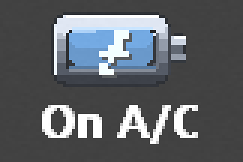
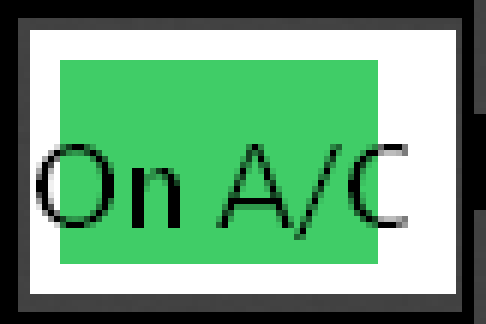
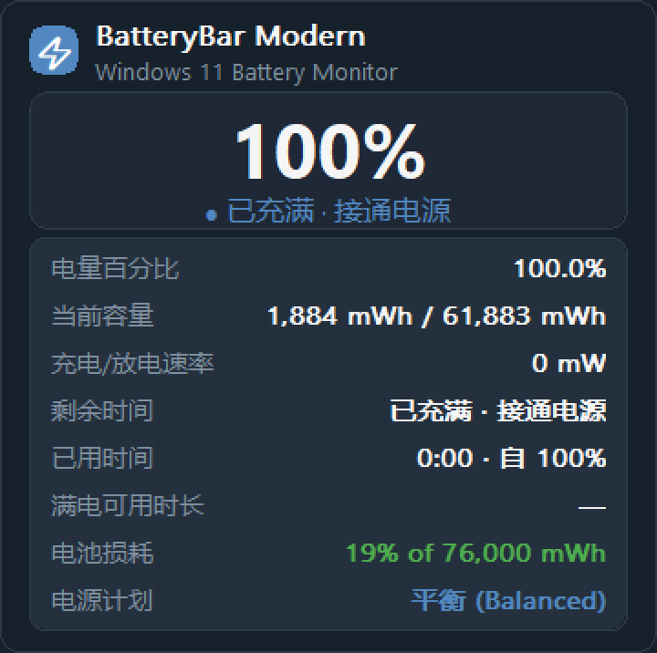
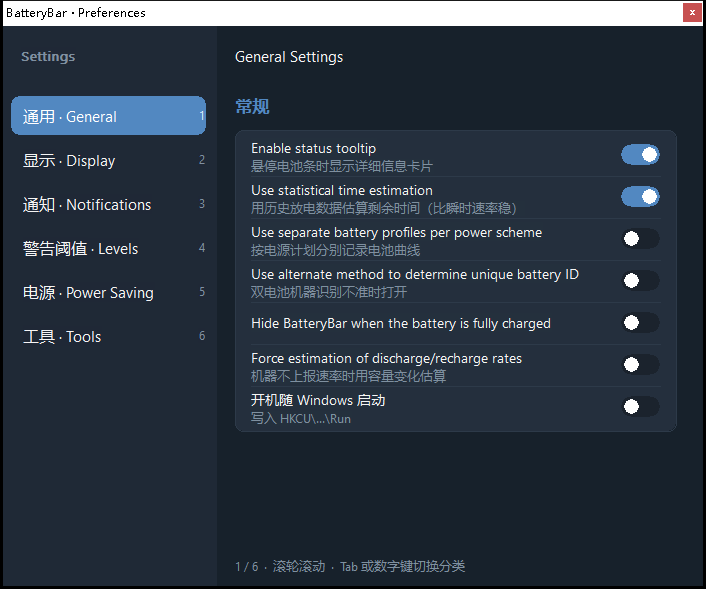
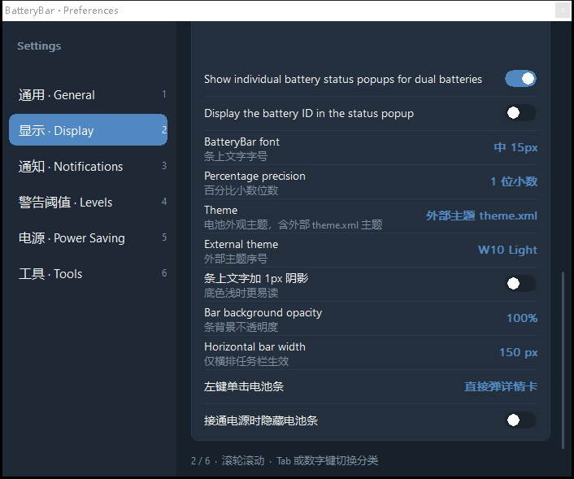
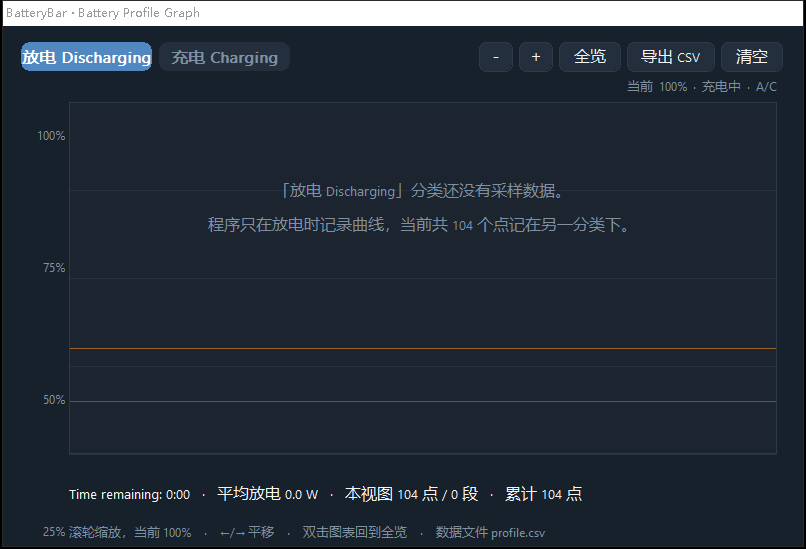
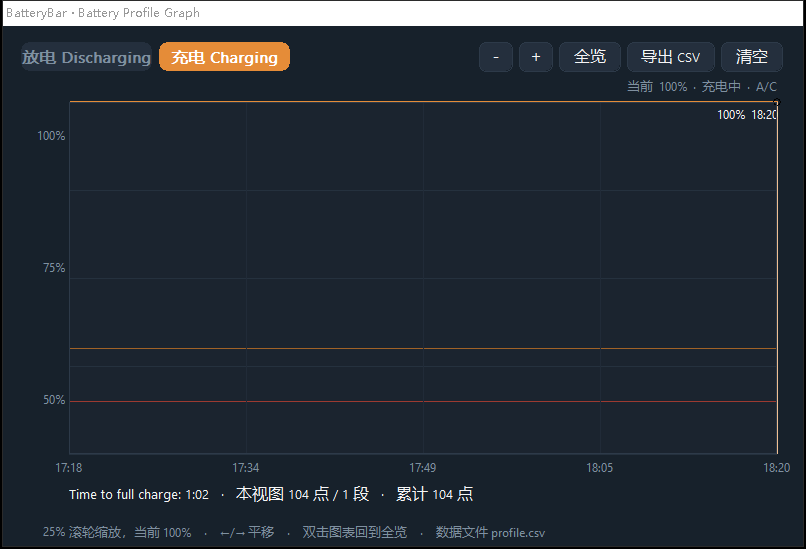

# BatteryBar Modern

现代开源版 BatteryBar：把电量条直接嵌进 Windows 10/11 任务栏，横排与竖排任务栏都支持，并复刻原版 BatteryBar Pro 的完整功能面 —— 独立电池曲线窗口、六分类设置面板、七字段状态详情卡、外部 `theme.xml` 主题包。Rust + windows-rs 实现，无运行时依赖、无需管理员权限。



## 功能

### 任务栏电量条

- **真·任务栏嵌入**：条窗口 `SetParent` 进 `Shell_TrayWnd`，不依赖 COM Deskband，因为 Win11 22H2 起已移除对 Deskband 的支持，同时也不需要签名或管理员权限
- **横排与竖排任务栏自适应**：宽条走「图标左 + 文字右」侧排，81px 窄条走「图标上 + 文字下」堆叠，两种布局都能同时放下图标与文字
- **5 种显示项**：Time Remaining 时间剩余 / Percent Remaining 电量百分比 / Time Finished 充满或放空的当日时刻 / Discharge-Charge Rate 充放电功率 / Capacity Remaining 剩余容量
  - 五项可任意勾选，单击条在**已勾选**的项之间轮播，与原版 `Alternate time remaining and percent` 行为一致
  - 满电接通电源时时间项显示 `On A/C`
  - Time Finished 项按原版 3.6.4 的格式显示当日时刻，例如 `@ 5:23 PM`
- **充电闪电**：手绘 7×7 像素掩码最近邻缩放，避开 `⚡` 字形在小尺寸下糊成一团

### 电池曲线窗口 Battery Profile Graph

原版 Pro 版的独立曲线窗口，本版完整实现：

- **放电 / 充电两张曲线**：按当前是否接通电源自动记录到对应分类，窗口内用两张 Tab 切换
- **实时刷新**：窗口打开时每 5 秒跟随最新采样重绘
- **采样与分段**：每 20 秒一个点，充放电切换与电量突变时立即补记；超过 5 分钟的间隔自动断开成新线段，避免把中间关机的时间画成一条斜线
- **缩放平移**：滚轮缩放、`←` `→` 平移、双击图表回到全览，`＋` `－` `全览` 三个按钮同效
- **阈值参考线**：叠加 Warning Levels 里设置的低电量线与临界线
- **图例随分类变化**：充电分类下图例显示 `Time to full charge`，与原版行为一致
- **导出 CSV** 与 **清空曲线数据**：前者把采样点写成 CSV，后者清空历史
- 采样文件 `profile.csv` 生成在 exe 同目录

### 状态详情卡

字段结构对齐原版 Status Popup：

- 顶部大号百分比 + 状态胶囊
- 电量百分比 / 当前容量 / 充放电速率 / 剩余时间 / 已用时间，附 `自 N%` 参考点 / 满电可用时长 / 电池损耗率 / 电源计划
- 容量与损耗按原版格式带千分位，例如 `1,884 mWh / 61,883 mWh`、`19% of 76,000 mWh`
- 悬停自动弹出，或左键单击条直接弹出，可在设置里二选一

### 设置面板：六分类分页

复刻原版 BatteryBar Pro Settings 的分类结构，左侧导航 + 右侧内容卡片：

| 分类 | 内容 |
|---|---|
| 通用 General | 状态提示卡、统计式时间估算、按电源计划分档案、备用电池 ID 判定、满电自动隐藏、强制速率估算、开机自启 |
| 显示 Display | 工具栏显示项勾选、默认显示项、单击轮播、充电时只显示百分比、双电池独立弹窗、详情卡显示电池 ID、字号、百分比精度、主题与外部主题选择、文字阴影、背景不透明度、横排条宽、单击行为、接通电源隐藏 |
| 通知 Notifications | Critical / Low / Finished charging 三组事件，每组都有音频提示、弹窗、自定义音频、主板蜂鸣、运行外部程序 |
| 警告阈值 Warning Levels | 按百分比或按剩余时间定义、低电量与临界阈值、Soft minimum、Full battery level、额外自定义警报阈值、临界自动动作 |
| 电源 Power Saving | 电池供电与接通电源两种情形分别设定切换电源计划、电池时禁用 Aero、仅在低于指定百分比时生效 |
| 工具 Tools | 打开曲线窗口、清空曲线数据、记录 BatteryStatus.log、详情卡显示实时功耗、重置学习历史、打开主题文件夹、重新扫描外部主题、恢复默认、打开程序目录 |

支持滚轮、拖动滚动条、`PageUp` `PageDown` `Home` `End`、数字键 `1`–`6` 切换到指定分类。

### 视觉主题

三种来源，在设置面板的「主题 Theme」里一键切换：

- **金属拟物**，默认：6 段金属渐变外壳 + 正极端子 + 内凹观察窗井 + 电解液液面，液面由双层色 + 弯月线 + 柔光斑 + 底部反光带构成，端子与壳体共用一条外轮廓
- **现代极简 Fluent**：扁平圆角轨道 + 蓝色填充条 + 细端子
- **外部主题**：读取原版 BatteryBar 的 `theme.xml` 主题包，可安装现成的第三方主题

外部主题放在 exe 同目录的 `themes\` 下，一个子目录一个主题，目录里放 `theme.xml`：

```
themes\
  W10Dark\
    theme.xml
    Background\  Charging\  Discharging\  ...
  W10Light\
    theme.xml
    ...
```

`theme.xml` 的结构与原版一致：

- 根节点 `<Theme>`，元数据有 `<Name>` `<Author>` `<Version>` `<MaxHeight>`
- `<States>` 内含五个状态：`Default` `Discharging` `LowBattery` `CriticalBattery` `Charging`
- 每个状态可定义 `Font` `TextColor` `TextShadow` `Padding` `Background` `ProgressBar` `HoverOverlay` `PressedOverlay`
- 每个图层要么给单张 `Center` 整体拉伸，要么给四角加四边的九宫格，两种情况都支持
- `TextColor` 写三个数表示 RGB，写四个数且末位为 0 表示该状态不显示文字
- `MaxHeight` 是该主题按像素设计的基准高度，实际渲染按任务栏条高自动等比缩放，因此同一个主题在横排与竖排任务栏下都合体
- 路径用反斜杠，相对 `theme.xml` 所在目录

程序启动时扫描一次，在设置面板「工具 Tools」页有「打开主题文件夹」与「重新扫描外部主题」两个动作，装完主题不必重启。

### 电源管理

- **电源计划切换**：右键菜单一键切平衡 / 节能 / 高性能
- **按情形自动切计划**：Power Saving 页可设定电池供电时与接通电源时分别切换到哪个计划
- **临界电量自动动作**：达到临界阈值可自动睡眠 / 关机 / 休眠 / 重启
- **统计式续航预测**：按历史放电记录拟合平均功率，与实时 EMA 各半融合估算剩余时间，避免刚拔电源时 ETA 剧烈跳动；拟合结果缓存 5 分钟

### 系统集成

- **数据源**：WinRT `Battery.AggregateBattery` 推送 + 30 秒兜底轮询 + `GetSystemPowerStatus` 内核级兜底，三层保证数据不丢
- **主题跟随**：读取 `AppsUseLightTheme` 自动切深色与浅色配色
- **Explorer 重启自愈**：每 5 秒检查条窗口，被 Explorer 重启摧毁则自动重建窗口并重新嵌入、重新定位
- **Per-Monitor V2 DPI 感知**
- **无任何控制台黑框**：`windows_subsystem = "windows"`，所有外部命令都带 `CREATE_NO_WINDOW`

## 截图

| 金属拟物主题 | 现代极简 Fluent |
|---|---|
|  |  |

| 外部主题 · W10 Dark | 外部主题 · W10 Light |
|---|---|
|  |  |







| 电池曲线窗口 · 放电 | 电池曲线窗口 · 充电 |
|---|---|
|  |  |

## 文字排版

- **字体族显式探测**：`CreateFontW` 对不存在的族不报错，它返回一个有效句柄，然后在 `SelectObject` 时静默替换成系统默认字体，实测被换成宋体衬线点阵，这正是早期版本任务栏文字很丑的真因。程序用 `EnumFontFamiliesExW` 枚举本机已安装族，按 `Segoe UI Variable Text → Segoe UI Variable Small → Segoe UI → Microsoft YaHei UI → Tahoma → Arial` 取第一个真实存在的
- **负高度字号**：`CreateFontW` 的 height 传负值表示字符高度，不含内部行距。传正值时 11px 的实际字面只有约 7px 高，在任务栏上根本读不清。三档为 13 / 15 / 17 px 字符高度
- **条高随字号伸缩**：竖排任务栏下条高 = 图标盒 26px + 间隙 + 文字行高，写死高度会在中大字号下把电池图标压成扁块
- **任务栏条用灰度抗锯齿**：ClearType 的 RGB 亚像素边在深色底 10–12px 字号下会显出橙蓝重影，灰度 AA 干净得多；卡片与面板仍用 ClearType

## 构建

需要 Rust，GNU 或 MSVC toolchain 均可：

```
cargo build --release
```

产物 `target/release/batterybar-modern.exe`，仅依赖系统 DLL，单文件分发。

## 运行

双击 `batterybar-modern.exe` 即可；配置文件 `options.json` 与采样文件 `profile.csv` 生成在 exe 同目录。退出走托盘右键菜单或条右键菜单的「退出」。

命令行参数：

```
--prefs              启动时直接打开设置面板
--prefs=tools        打开设置面板并跳到指定分类，可选 general/display/notifications/levels/power/tools
--graph              启动时直接打开电池曲线窗口
```

## 已知限制

- 任务栏底色按主题近似贴色，极端自定义主题下可能有轻微色差
- 背景不透明度低于 100% 时，合成结果取决于任务栏自身的 Acrylic 状态
- **「横排电池条宽度」只在横排任务栏生效**：竖排任务栏下条宽必须等于任务栏宽度，否则会露出缝，程序会忽略该设置
- **曲线需要时间积累**：放电与充电曲线各自独立记录，刚装上时打开窗口只会看到空态提示，属正常现象
- **外部主题只解析 `theme.xml`**：原版部分主题用 `.theme` 打包格式，本版只认目录式的 `theme.xml`；把主题包解压到 `themes\<名字>\` 即可
- **外部主题的字体作用于条上文字**：主题里 `<Font>` 指定的族若本机没装，会静默落到系统默认字体，与原版行为相同
- **开机自启需要普通目录**：自启项写在 `HKCU\Software\Microsoft\Windows\CurrentVersion\Run`，该键要求中完整性级别。若 exe 位于被标记为低完整性级别的目录，例如受沙箱管控的目录，写注册表会被系统拒绝，此时设置面板会提示并把开关回滚为关闭。把 exe 移到普通目录即可正常使用

## License

MIT
