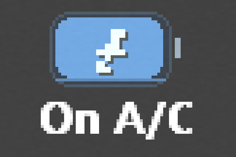
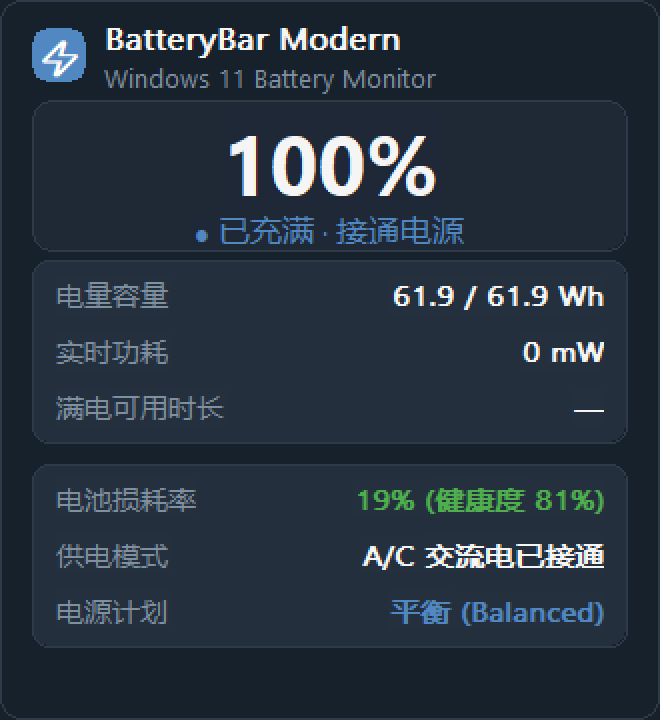
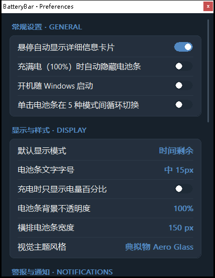

# BatteryBar Modern

现代开源版 BatteryBar：把电量条直接嵌进 Windows 10/11 任务栏（横排/竖排任务栏均支持），带系统托盘图标、详情卡片与完整设置面板。Rust + windows-rs 实现，无运行时依赖、无需管理员权限。


## 功能

### 任务栏电量条

- **真·任务栏嵌入**：条窗口 `SetParent` 进 `Shell_TrayWnd`（TrafficMonitor 同款方案），不依赖 COM Deskband（Win11 22H2+ 已移除其支持），无需签名/管理员
- **横排与竖排任务栏自适应**：宽条走「图标左 + 文字右」侧排，81px 窄条走「图标上 + 文字下」堆叠，两种布局都能同时放下图标与文字
- **5 种显示模式**：时间剩余 / 电量百分比 / 实时功率（充放电速率 W）/ 剩余容量（Wh）/ 仅图标
  - 单击条循环切换；可在设置里改成「单击直接弹详情卡」
  - 满电接通电源时时间模式显示 `On A/C`（原版 BatteryBar 行为）
- **充电闪电**：手绘 7×7 像素掩码最近邻缩放，避开 `⚡` 字形在小尺寸下糊成一团

### 两套视觉主题

- **金属拟物**（默认）：6 段金属渐变外壳 + 正极端子 + 内凹观察窗井 + 电解液液面（双层 + 弯月线 + 柔光斑 + 底部反光带），端子与壳体共用一条外轮廓
- **现代极简 Fluent**：扁平圆角轨道 + 蓝色填充条 + 细端子

在设置面板的「视觉主题风格」里一键切换。

### 状态详情卡与设置面板

- **悬停弹详情卡**：大号百分比 + 状态胶囊 + 电量容量 / 实时功耗 / 满电可用时长 / 电池损耗率 / 供电模式 / 电源计划
- **设置面板**（双击条或右键菜单 `Preferences...`）六个分组：
  - **常规设置 GENERAL** — 悬停显示详情、满电自动隐藏、开机自启、单击循环切换
  - **显示与样式 DISPLAY** — 默认显示模式、文字字号（13/15/17 px）、充电时只显示百分比、背景不透明度、横排电池条宽度（100/150/200/300/400 px）、视觉主题风格
  - **警报与通知 NOTIFICATIONS** — 低电气泡、临界气泡、充满电提示、提示音、自定义电量警报
  - **警告阈值 WARNING LEVELS** — 低电阈值、临界阈值、临界自动动作（睡眠/关机/休眠/重启）
  - **行为 BEHAVIOR** — 左键单击行为、接通电源时隐藏电池条
  - **算法与工具 BATTERY TOOLS** — 详情卡展示实时功耗、全寿命自学习预测、重置放电学习记录、恢复默认设置
- 设置面板支持滚轮 / 拖动滚动条 / PageUp·PageDown·Home·End 四种滚动方式

### 文字排版

- **字体族显式探测**：`CreateFontW` 对不存在的族**不报错** —— 它返回有效句柄，然后在 `SelectObject` 时静默替换成系统默认字体（实测被换成宋体，衬线点阵，这就是早期版本任务栏文字「很丑」的真因）。程序启动时用 `EnumFontFamiliesExW` 枚举本机已安装族，按 `Segoe UI Variable Text → Segoe UI Variable Small → Segoe UI → Microsoft YaHei UI → Tahoma → Arial` 取第一个真实存在的
- **负高度字号**：`CreateFontW` 的 `height` 传负值表示字符高度（不含内部行距）。传正值时 11px 的实际字面只有约 7px 高，在任务栏上根本读不清。三档为 13 / 15 / 17 px 字符高度
- **条高随字号伸缩**：竖排任务栏下条高 = 图标盒 26px + 间隙 + 文字行高。写死高度会在中大字号下把电池图标压成扁块
- **任务栏条用灰度抗锯齿**：ClearType 的 RGB 亚像素边在深色底 10~12px 字号下会显出橙蓝重影，灰度 AA 干净得多；卡片与面板仍用 ClearType

### 电源管理

- **电源计划切换**：右键菜单一键切平衡 / 节能 / 高性能（调 `powercfg`）
- **临界电量自动动作**：达到临界阈值可自动睡眠 / 关机 / 休眠 / 重启
- **自学习续航预测**：按历史放电曲线拟合平均功率，与实时 EMA **各半融合**估算剩余时间（避免刚拔电源时 ETA 剧烈跳动）；拟合结果缓存 5 分钟

### 系统集成

- **数据源**：WinRT `Battery.AggregateBattery` 推送（`ReportUpdated`）+ 30s 兜底轮询 + `GetSystemPowerStatus` 内核级兜底，三层保证数据不丢
- **主题跟随**：读取 `AppsUseLightTheme` 自动切深/浅配色（配色基准 Telegram 主题令牌）
- **Explorer 重启自愈**：每 5s 检查条窗口，被 Explorer 重启摧毁则自动重建窗口并重新嵌入、重新定位
- **Per-Monitor V2 DPI 感知**
- **无任何控制台黑框**：`windows_subsystem = "windows"` + 所有外部命令（`powercfg` / `shutdown` / `rundll32`）带 `CREATE_NO_WINDOW`

## 截图

| 金属拟物主题 | 现代极简 Fluent |
|---|---|
|  |  |





## 构建

需要 Rust（GNU 或 MSVC toolchain 均可）：

```
cargo build --release
```

产物 `target/release/batterybar-modern.exe`，仅依赖系统 DLL，单文件分发。

## 运行

双击 `batterybar-modern.exe` 即可；配置文件 `options.json` 生成在 exe 同目录。退出走托盘右键菜单或条右键菜单的「退出」。

命令行参数：`--prefs` / `-p` 启动时直接打开设置面板。

## 已知限制

- 任务栏底色按主题近似贴色，极端自定义主题下可能有轻微色差
- 背景不透明度低于 100% 时，合成结果取决于任务栏自身的 Acrylic 状态
- **「横排电池条宽度」只在横排任务栏生效**：竖排任务栏下条宽必须等于任务栏宽度（否则会露出缝），程序会忽略该设置
- **开机自启需要普通目录**：自启项写在 `HKCU\Software\Microsoft\Windows\CurrentVersion\Run`（中完整性级别）。若 exe 位于被标记为低完整性级别的目录（例如受沙箱管控的目录），写注册表会被系统拒绝，此时设置面板会弹出提示并自动把开关回滚为关闭状态。把 exe 移到普通目录（如下载目录、程序目录）即可正常使用

## License

MIT
